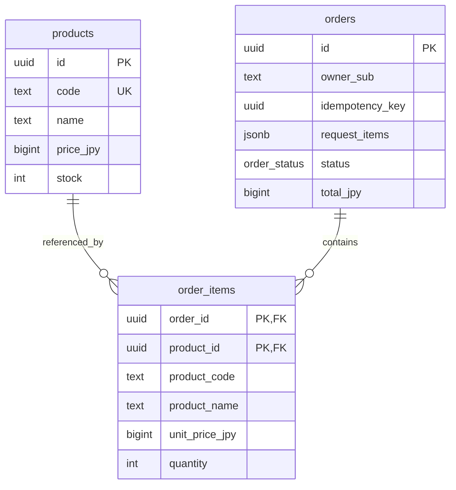

# training2 数据库设计

数据库定义只维护 packages/postgres/migrations 的 SQL；最新列、约束、索引、枚举、函数和触发器由空数据库生成的 packages/postgres/schemas/current.json 提供。Prisma 在 Step4 从这个 SQL 定义的数据库反向生成。

## 表与关联

库存只存在 products.stock。明细保存商品代码、名称和创建时单价快照。orders 的 owner_sub 与 idempotency_key 联合唯一；明细的订单与商品联合主键禁止重复商品。商品被明细引用时不能删除；删除订单会级联删除明细，但初期 API 不提供删除功能。

金额为 JPY BIGINT。驱动默认返回 bigint 的字符串；API DTO 在 Step7 明确检查安全整数并转换，不能直接把 DB 行当响应。总金额上限 5 万亿日元仍在 JavaScript 安全整数范围内。

## 数据库与服务的边界

DB 保证规范化商品代码唯一、范围和长度、外键、数量、状态枚举及状态时间戳的结构约束。JSONB 创建输入仅在 DB 校验数组形状和 1 到 50 个元素；每个输入对象的字段、去重和规范化由 API 与服务验证。

订单拥有 1 到 50 个真实明细、总额等于明细金额、保存快照、合法状态迁移，以及状态与库存一致性，属于跨行和业务规则，由 Step11 的事务实现与实际业务测试验证。Step3 的表与约束不代表订单业务已经实现。

updated_at 由 SQL 触发器更新。draft 不含确认和取消时间，confirmed 含确认时间，cancelled 含取消时间；确认时间可为空以支持草稿直接取消。时间字段保证不早于创建时间及已存在的确认时间。

## 搜索索引

商品代码唯一 B-tree 支持代码查询和升序分页。名称通过 lower(name) 的 pg_trgm GIN 索引支持字面子串搜索，具体转义在后续 API 实现；短搜索条件仍可能使用顺序扫描。订单索引包含 owner_sub、创建时间和 ID；明细另有商品外键索引。

## 迁移与复现

每次迁移在一个实际 PostgreSQL 事务中取得 advisory lock，再校验 SHA256 历史和连续编号，全部新增 SQL 与历史一起提交。重复执行跳过历史；并发执行串行化；失败全部回滚。已应用历史不可修改或删除。追加历史版本进行修复，不直接运行 DDL 修改设计。

清单生成和 DB 测试创建独立 training2_test_ 数据库，执行后清理，只清理自己创建的数据库。不得对生产地址运行测试工具。迁移、seed 和生成命令见 [数据库操作说明](https://github.com/changxu-advanced/training2/blob/main/packages/postgres/README.md)。

## 已验证

13 个 PostgreSQL 测试检查了重复和非法代码、库存和价格范围、Unicode 名称和说明长度、订单幂等键、非法总额与状态、时间戳、数量、外键、重复明细、更新时间、seed 重复运行、空库重建、并发迁移和失败回滚。加上 Step2 的 config/logger 共 23 个测试。

验收场景 AC-D01 和 AC-D02 的 SQL 迁移及直接 DB 写入部分已经验证；AC-D01 的 Prisma 生成在 Step4 完成。并发订单确认和取消属于 Step11/12，不用并发迁移测试替代。
